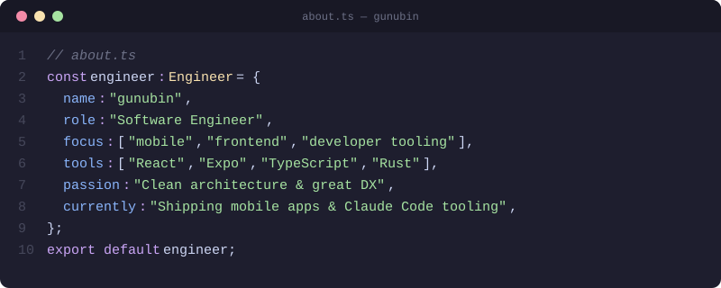

  

 

I build tools for Claude Code and terminal workflows, and ship React Native apps at [@shanord-inc](https://github.com/shanord-inc).
I write about what I make at [mono-and.blog](https://mono-and.blog).

 

## Featured Projects

| Project | What it does |
|---|---|
| [clawd-in-ghostty](https://github.com/gunubin/clawd-in-ghostty) | Clawd, the Claude Code mascot, lives in your tmux panes while Claude works. A single Ghostty shader. |
| [claude-panes](https://github.com/gunubin/claude-panes) | TUI dashboard to monitor and switch between Claude Code tmux sessions. Rust. |
| [cc-pick](https://github.com/gunubin/cc-pick) | Interactive CLI for configuring Claude Code MCP servers and plugins per project. `npx @gunubin/cc-pick` |
| [intent](https://github.com/gunubin/intent) | Version control for intent: tracks the decisions and friction behind AI-assisted development. |
| [redline-ai](https://github.com/gunubin/redline-ai) | Inline AI editing for local files. Preview in the browser, select text, tell the agent what to change. |
| [dotfiles](https://github.com/gunubin/dotfiles) | fish, tmux, Neovim, Ghostty and Claude Code hooks, managed with GNU Stow. |

 

## Tech Stack

Also: Python, Astro, Tailwind CSS, Prisma, Docker, Turborepo, Biome, Vitest, Ink, MCP SDK

 

  

